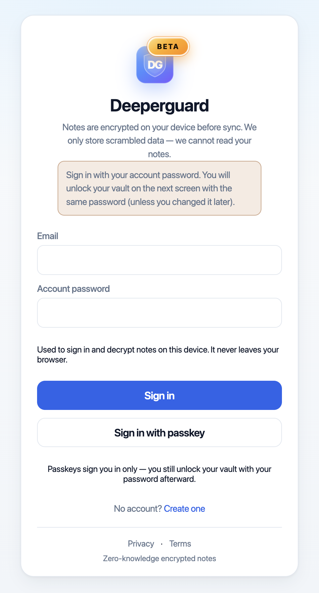

# Deeperguard

Encrypted notes in your browser.

**[Open the notes app](https://www.deeperguard.com/app)**



## What it does

Deeperguard is a notes app that runs in the browser. You write, tag, search, pin, archive, and trash notes, attach files, use checklists and markdown, and scan documents. The same vault opens on your phone or computer, including from the home screen.

## Sign-in

The screen above takes an email and an account password. The password stays in the browser. Sign-in is SRP-6a over SHA-256 and the RFC 5054 2048-bit group: the client sends a proof, and the server stores only a salt and a verifier. A passkey (WebAuthn) can take the place of that step.

The next screen unlocks the vault on the device. The server never checks the vault password. A passkey signs you in only; the vault still unlocks with the password.

## Vault

New vaults derive a 32-byte key with Argon2id: 3 iterations, 64 MiB of memory, parallelism 2, from the password and a per-account salt. Older vaults still open with the legacy SHA-256 derivation.

Titles, bodies, tags, attachments, extracted document text, and version history are encrypted as JSON with AES-256-GCM and a random 12-byte IV before anything is uploaded. Decryption runs in the browser after unlock.

## On the device

The ciphertext is cached in IndexedDB, so notes open offline and the site can be added to the home screen as a PWA. Scans and PDFs are read with Tesseract and pdf.js in the browser; the text is encrypted into the note, and search runs on the decrypted copy locally. Each edit keeps the previous copy inside the encrypted note, so an older version can be restored.

## What the server holds

Ciphertext blobs, the SRP verifier, the account email, sessions, and sync metadata: item ids, timestamps, and sizes. Reminder email does not include note titles.

Accounts start on the Free plan (50&nbsp;MB, sync, attachments, on-device OCR). Basic and Pro add higher limits; Pro adds passkeys, account 2FA, backups, reminders, and the vault authenticator. Paid plans use Stripe Checkout and the Stripe Customer Portal when billing env vars are configured (test mode first).

[www.deeperguard.com](https://www.deeperguard.com)

## Build from source (client integrity)

The browser app is plain static JS/CSS (no bundler). A deterministic manifest
hashes every shipped script and stylesheet so you can verify what the origin
serves.

**Toolchain pins**

- Python: `.python-version` (`3.11`) and `requirements.lock` (from `requirements.txt`)
- Node: `.nvmrc` (`18`) — used for the JS test suite only; there is no frontend npm build

**Reproduce the client manifest**

```bash
git clone https://github.com/deeperguard/Deeperguard.git
cd Deeperguard
git checkout <tag-or-commit>
export SOURCE_DATE_EPOCH=0
python3 scripts/build-client-manifest.py --print-hash
```

Two runs with the same tree and `SOURCE_DATE_EPOCH` must print the same
`manifest_sha256`. That value is exposed in the app (Settings → About), in
`GET /api/health` as `client_hash`, and in the signed `client-manifest.json`
attached to each GitHub Release (`v*` tags). Releases are signed with Sigstore
Cosign keyless (Rekor). See [/verify](https://www.deeperguard.com/verify) for
the full check (in-app hash → release manifest → `cosign verify-blob` → rebuild).

A pinned build (browser extension or desktop app) is the strongest integrity
option if one is published later — a normal web origin can always change what
it serves next.

**GitHub Actions**

Workflow YAML lives in `deploy/github-workflows/` (`client-integrity.yml` dual
build check, `release-client.yml` Cosign keyless release on `v*` tags). Copy
both into `.github/workflows/` on a machine whose GitHub token has the
`workflow` scope (the default OAuth app used by some agents cannot create
workflow files):

```bash
mkdir -p .github/workflows
cp deploy/github-workflows/*.yml .github/workflows/
git add .github/workflows && git commit -m "Enable client integrity GitHub Actions" && git push
```

## Stripe billing (Basic / Pro)

Configure in `config/deeperguard.env` (never commit secrets). Create four EUR recurring Prices in the Stripe Dashboard (Basic €2.99/mo, €29/yr; Pro €6.99/mo, €69/yr) and set:

- `STRIPE_SECRET_KEY` — test secret key first (`sk_test_…`)
- `STRIPE_WEBHOOK_SECRET` — signing secret for `POST /api/billing/stripe/webhook`
- `STRIPE_PRICE_BASIC_MONTHLY`, `STRIPE_PRICE_BASIC_YEARLY`, `STRIPE_PRICE_PRO_MONTHLY`, `STRIPE_PRICE_PRO_YEARLY` — Price IDs (`price_…`)
- Optional: `STRIPE_PUBLISHABLE_KEY`, `STRIPE_BILLING_ENABLED=0` to disable without removing keys

`plan_pricing.billing_active` is true when the secret key and all four price IDs are set. Subscriptions cancel at period end via the Customer Portal; webhooks move the account to Free after the paid period.

## Source available for review

The client and application source are published on GitHub so you can inspect encryption, sync, and client logic. The [Business Source License 1.1](LICENSE) allows inspection, audit, and non-production evaluation; **production or commercial use requires a separate agreement** with the licensor. Never commit infrastructure secrets (`config/deeperguard.env`, `keys/`, `data/`, or API tokens).

Cross-check what you run in the browser on [/verify](https://www.deeperguard.com/verify) (release hashes, Sigstore, reproducible client manifest).

[LICENSE](LICENSE) · [Privacy](docs/PRIVACY.md) · [Security](SECURITY.md) · [Self-host](docs/SELF_HOST.md) · [Verify](https://www.deeperguard.com/verify)
